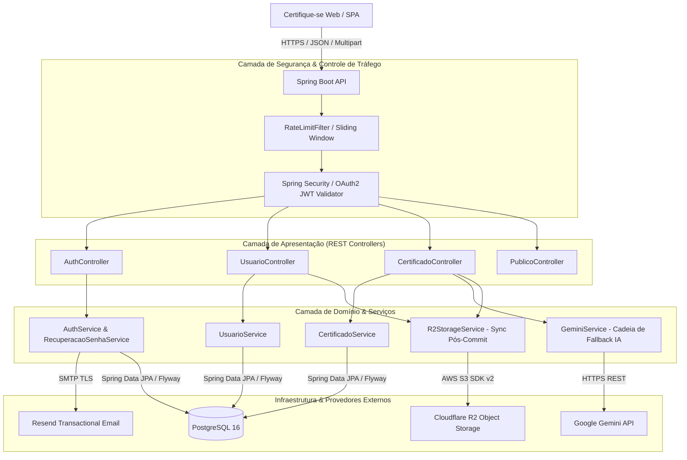

# 🎖️ Certifique-se — Backend API

> **API RESTful corporativa para gerenciamento, validação e exibição pública de certificações profissionais, equipada com extração multimodal via Inteligência Artificial (Google Gemini) e armazenamento em nuvem de alta performance (Cloudflare R2).**

<p align="center">
  
  
  
  
  
  
  
</p>

---

## 📌 Sumário

- [Visão Geral](#-visão-geral)
- [Principais Funcionalidades](#-principais-funcionalidades)
- [Arquitetura do Sistema](#-arquitetura-do-sistema)
- [Stack Tecnológica](#-stack-tecnológica)
- [Mapeamento da Estrutura do Projeto](#-mapeamento-da-estrutura-do-projeto)
- [Especificação de Endpoints (API REST)](#-especificação-de-endpoints-api-rest)
- [Segurança, Resiliência e Governança](#-segurança-resiliência-e-governança)
- [Integrações Externas](#-integrações-externas)
- [Regras de Negócio e Limites Operacionais](#-regras-de-negócio-e-limites-operacionais)
- [Qualidade e Testes Automatizados](#-qualidade-e-testes-automatizados)
- [Propriedade e Direitos](#-propriedade-e-direitos)

---

## 🎯 Visão Geral

O **Certifique-se Backend** é o núcleo transacional e de inteligência da plataforma **Certifique-se** ([certifique-se.app](https://certifique-se.app)), projetado para solucionar a dispersão de certificados, diplomas e comprovantes de qualificação profissional.

A arquitetura do serviço sustenta três pilares principais:
1. **Centralização e Integridade**: Catalogação estruturada de certificações com geração de assinatura única (`SHA-256`) por documento para prevenção de duplicidades e garantia de autenticidade.
2. **Automação Cognitiva (Zero-Data-Entry)**: Processamento multimodal de imagens (`JPEG`, `PNG`, `WebP`) e documentos (`PDF`) via Google Gemini para extração instantânea e estruturada de título do curso, instituição emissora, carga horária, data de conclusão, competências e link oficial de validação.
3. **Portfólio Público de Alta Disponibilidade**: Exposição controlada de perfis profissionais (`/public/usuarios/{username}`), consolidando métricas de horas complementares, habilidades e comprovantes verificáveis.

---

## ✨ Principais Funcionalidades

- 🤖 **Extração Multimodal via Inteligência Artificial (OCR Cognitivo)**:
  - Integração direta com a família de modelos **Google Gemini** (`gemini-3.8-flash` com cadeia de fallback resiliente para `gemini-3.5-flash` e `gemini-3.5-flash-lite`).
  - Extração guiada por **JSON Schema estrito** e instruções de sistema anti-alucinação (descarta nomes de alunos como títulos de cursos, higieniza termos genéricos, valida intervalos temporais entre 1960 e a data atual e padroniza URLs de verificação).
- ☁️ **Armazenamento Distribuído em Nuvem (Cloudflare R2)**:
  - Persistência de certificados e avatares compatível com a API AWS S3 v2 e chaves únicas baseadas em UUID.
  - Entrega otimizada de mídia (`/certificados/imagens/{chave}`) com políticas de cache público imutável (`max-age=31536000, immutable`).
  - Consistência transacional entre banco e storage: exclusões de objetos no R2 são executadas exclusivamente após a confirmação do commit no PostgreSQL (`TransactionSynchronizationManager`).
- 🌐 **Vitrine e Portfólio Público**:
  - Endpoints públicos otimizados para leitura de perfil, biografia, headline, totalizador de horas e certificados autorizados pelo titular.
  - Controle de privacidade em nível de conta e por certificado individual.
- 🔐 **Autenticação Stateless & Revogação Instantânea**:
  - Autenticação baseada em **OAuth2 Resource Server (JWT)** assinados com HMAC-SHA256.
  - Mecanismo de invalidação imediata de sessões via claim `tokenVersion`, revogando tokens emitidos anteriormente assim que ocorre uma alteração ou redefinição de senha.
- ⏱️ **Rate Limiting por Janela Deslizante (Sliding Window)**:
  - Proteção nativa em memória contra ataques de força bruta, abuso de envio de e-mails e exaustão de cota de IA, com reconhecimento de cabeçalhos de proxy reverso (`CF-Connecting-IP` e `X-Forwarded-For`).
- 📧 **Fluxo Criptográfico de Recuperação de Senha**:
  - Geração de tokens de alta entropia via `SecureRandom` com expiração estrita de 30 minutos.
  - Persistência exclusiva do hash `SHA-256` do token no banco de dados e disparo transacional via SMTP (Resend) com template HTML responsivo.
- 🔍 **Consultas Dinâmicas**:
  - Filtragem avançada e combinada por título, instituição, data de conclusão e tags utilizando **JPA Specifications**.

---

## 🏛️ Arquitetura do Sistema



---

## 💻 Stack Tecnológica

| Camada | Tecnologia / Biblioteca | Versão | Papel na Arquitetura |
| :--- | :--- | :--- | :--- |
| **Linguagem** | Java (Eclipse Temurin) | `21 (LTS)` | Runtime principal e recursos modernos da linguagem |
| **Framework Core** | Spring Boot | `4.0.5` | Injeção de dependência, web server e ecossistema corporativo |
| **Persistência** | Spring Data JPA / Hibernate | `7.2.x` | Mapeamento objeto-relacional e Specifications dinâmicas |
| **Banco de Dados** | PostgreSQL | `16` | Persistência relacional transacional |
| **Versionamento SQL** | Flyway | `11.14.x` | Governança e evolução automatizada de schema (`V0` a `V5`) |
| **Segurança** | Spring Security & OAuth2 JWT | Nativo | Autenticação stateless, RBAC e validação criptográfica de tokens |
| **Object Storage** | AWS SDK for Java v2 (S3) | `2.54.19` | Comunicação S3-compatible com o Cloudflare R2 |
| **Inteligência Artificial** | Google Gemini API | `v1beta` | Visão computacional, OCR e extração estruturada de metadados |
| **Mensageria de E-mail** | Spring Boot Starter Mail | Nativo | Disparo de e-mails transacionais via Resend SMTP |
| **Especificação de API** | SpringDoc OpenAPI (Swagger) | `2.8.9` | Documentação técnica automatizada sob o padrão OpenAPI 3.0 |

---

## 📂 Mapeamento da Estrutura do Projeto

```text
Certifique-se/
├── README.md                                       # Documentação arquitetural do Backend
└── certifiquese/                                   # Módulo principal Spring Boot
    ├── Dockerfile                                  # Definição de imagem multi-stage (JDK 21 -> JRE 21)
    ├── pom.xml                                     # Manifesto de dependências e build Maven
    └── src/
        ├── main/
        │   ├── java/br/com/certifiquese/
        │   │   ├── CertifiqueseApplication.java    # Ponto de entrada da aplicação
        │   │   ├── config/                         # Beans de infraestrutura (S3Client / Cloudflare R2)
        │   │   ├── controller/                     # Endpoints RESTful
        │   │   │   ├── AuthController.java         # Autenticação e ciclo de recuperação de senha
        │   │   │   ├── UsuarioController.java      # Gestão de conta, perfil, avatar e credenciais
        │   │   │   ├── CertificadoController.java  # CRUD de certificados, upload e extração via IA
        │   │   │   └── PublicoController.java      # Vitrine pública de portfólios e healthcheck
        │   │   ├── dto/                            # Java Records imutáveis para contratos de entrada/saída
        │   │   ├── exception/                      # Tratamento global padronizado (RFC 7807 ProblemDetail)
        │   │   ├── model/                          # Entidades JPA e mapeamento relacional
        │   │   ├── repository/                     # Interfaces Spring Data JPA
        │   │   ├── security/                       # Arquitetura de segurança
        │   │   │   ├── authentication/             # Implementações customizadas de UserDetails
        │   │   │   ├── config/                     # Políticas CORS, CSRF, HSTS, filtros e decoders JWT
        │   │   │   ├── ratelimit/                  # Motor Sliding Window de limitação de taxa por IP
        │   │   │   └── token/                      # Emissão, assinatura e validação de claims JWT
        │   │   ├── service/                        # Camada de regras de negócio e orquestração
        │   │   │   ├── email/                      # Abstração e implementação de envio de e-mails
        │   │   │   ├── storage/                    # Integração transacional com Cloudflare R2
        │   │   │   ├── AuthService.java            # Fluxos de login e geração de credenciais
        │   │   │   ├── CertificadoService.java     # Regras de domínio, hashes SHA-256 e cotas de plano
        │   │   │   ├── GeminiService.java          # Cliente multimodal Gemini com fallback automático
        │   │   │   ├── RecuperacaoSenhaService.java# Gestão criptográfica de tokens de redefinição
        │   │   │   └── UsuarioService.java         # Regras de perfil e ciclo de vida da conta
        │   │   ├── specification/                  # Critérios dinâmicos de busca (JPA Specifications)
        │   │   └── validation/                     # Annotations e validadores customizados (Bean Validation)
        │   └── resources/
        │       └── db/migration/                   # Scripts evolutivos Flyway (V0__ a V5__)
        └── test/                                   # Suíte de testes automatizados de unidade e integração
```

---

## 📡 Especificação de Endpoints (API REST)

### 🔐 1. Autenticação (`/auth`)

| Método | Endpoint | Acesso | Rate Limit | Descrição |
| :--- | :--- | :--- | :--- | :--- |
| `POST` | `/auth/login` | Público | 10 req/min | Autentica credenciais e emite o token JWT assinado com `tokenVersion`. |
| `POST` | `/auth/esqueci-senha` | Público | 5 req/2min | Gera token criptográfico e envia link de recuperação por e-mail. |
| `POST` | `/auth/redefinir-senha` | Público | Livre | Valida o hash do token de recuperação, define nova senha e revoga sessões. |

### 👤 2. Usuários (`/usuarios`)

| Método | Endpoint | Acesso | Descrição |
| :--- | :--- | :--- | :--- |
| `POST` | `/usuarios` | Público | Registra uma nova conta de usuário na plataforma. |
| `GET` | `/usuarios/me` | Autenticado | Retorna o perfil completo do usuário autenticado. |
| `PUT` | `/usuarios/me` | Autenticado | Atualiza dados do perfil (nome, headline, bio, username e visibilidade pública). |
| `PUT` | `/usuarios/me/senha` | Autenticado | Atualiza a senha mediante confirmação da atual e incrementa `tokenVersion`. |
| `POST` | `/usuarios/me/foto` | Autenticado | Realiza upload de novo avatar no Cloudflare R2 e remove o anterior pós-commit. |
| `DELETE` | `/usuarios/me/foto` | Autenticado | Remove a foto de perfil ativa do banco de dados e do storage em nuvem. |
| `DELETE` | `/usuarios/me` | Autenticado | Encerra a conta permanentemente e limpa todos os certificados e mídias no R2. |
| `GET` | `/usuarios` | `ROLE_ADMIN` | Lista todas as contas registradas para auditoria administrativa. |

### 📜 3. Certificados (`/certificados`)

| Método | Endpoint | Acesso | Rate Limit | Descrição |
| :--- | :--- | :--- | :--- | :--- |
| `POST` | `/certificados/extrair-dados` | Autenticado | 15 req/min | Analisa imagem/PDF via Google Gemini, armazena no R2 e retorna metadados estruturados. |
| `POST` | `/certificados/imagens` | Autenticado | Livre | Realiza upload avulso de comprovante no Cloudflare R2. |
| `GET` | `/certificados/imagens/{chave}` | Público | Livre | Entrega o arquivo armazenado no R2 com cabeçalhos de cache imutável de 1 ano. |
| `POST` | `/certificados` | Autenticado | Livre | Registra um novo certificado validando cotas do plano e unicidade via hash `SHA-256`. |
| `PUT` | `/certificados/{hash}` | Autenticado | Livre | Atualiza metadados e anexo do certificado (com expurgo automático de mídia obsoleta). |
| `GET` | `/certificados/me` | Autenticado | Livre | Lista os certificados do titular com filtros dinâmicos (`nome`, `empresa`, `dataConclusao`, `tags`). |
| `DELETE` | `/certificados/{hash}` | Autenticado | Livre | Remove o registro do certificado e exclui o respectivo arquivo no Cloudflare R2. |
| `GET` | `/certificados` | `ROLE_ADMIN` | Livre | Consulta global de certificados para governança administrativa. |

### 🌍 4. Vitrine Pública & Operação (`/public`)

| Método | Endpoint | Acesso | Descrição |
| :--- | :--- | :--- | :--- |
| `GET` | `/public/usuarios/{username}` | Público | Retorna os dados públicos do portfólio, somatório de horas e total de conquistas. |
| `GET` | `/public/usuarios/{username}/certificados` | Público | Lista os certificados marcados como públicos pelo titular (respeitando limites do plano). |
| `GET` | `/public/health` | Público | Endpoint de monitoramento de disponibilidade (`status` e `timestamp`). |

---

## 🛡️ Segurança, Resiliência e Governança

1. **Invalidação Instantânea de Sessões (`tokenVersion`)**:
   - Todo token JWT carrega a versão de credencial do usuário. Ao alterar ou redefinir a senha, o contador é incrementado na base relacional, invalidando imediatamente qualquer token emitido anteriormente sem necessidade de listas de bloqueio externas.
2. **Proteção de Borda com Rate Limiting (Sliding Window)**:
   - Implementação thread-safe baseada em `ConcurrentLinkedDeque` por endereço IP real, mitigando ataques de dicionário no login, flooding de e-mails transacionais e uso abusivo do motor de Inteligência Artificial.
3. **Hardening de Cabeçalhos HTTP & Erros Padronizados**:
   - Políticas **HSTS** (`max-age=31536000; includeSubDomains`), `X-Frame-Options: SAMEORIGIN` e `X-Content-Type-Options: nosniff` habilitadas por padrão.
   - Respostas de erro seguem a especificação **RFC 7807 (`ProblemDetail`)**, evitando vazamento de stack traces ou detalhes internos de infraestrutura.
4. **Sincronização Transacional de Storage**:
   - Exclusões de arquivos no Cloudflare R2 são vinculadas ao ciclo de vida da transação JPA (`afterCommit`), garantindo que falhas ou rollbacks no banco de dados jamais causem perda prematura de arquivos físicos na nuvem.

---

## 🔌 Integrações Externas

### 1. Google Gemini API (Motor de Extração Documental)
- **Alta Disponibilidade por Cadeia de Fallback**: Opera com o modelo primário `gemini-3.8-flash` e comuta transparentemente para `gemini-3.5-flash` e `gemini-3.5-flash-lite` em cenários de saturação (`HTTP 429`), indisponibilidade temporária (`HTTP 503`) ou timeout.
- **Governança de Dados**: Utiliza `responseSchema` nativo e pós-processamento determinístico para garantir tipos válidos, normalizar URLs de autenticidade e filtrar ruídos comuns de OCR.

### 2. Cloudflare R2 (Object Storage S3-Compatible)
- Integração via **AWS SDK v2** com assinatura SigV4 e suporte híbrido: entrega via proxy de aplicação com cache de longa duração ou resolução direta via CDN customizada.

### 3. Resend (Mensageria Transacional SMTP)
- Canal seguro sob TLS para entrega de comunicações críticas de segurança e recuperação de conta.

---

## ⚖️ Regras de Negócio e Limites Operacionais

A plataforma aplica políticas de governança e controle de recursos de acordo com o perfil da conta:

| Diretriz / Limite | Conta Padrão (`USER`) | Administrador (`ADMIN`) |
| :--- | :--- | :--- |
| **Acervo Total de Certificados** | Até **15 certificados** | Ilimitado |
| **Exibição Simultânea no Portfólio Público** | Até **8 certificados** | Ilimitado |
| **Tamanho Máximo por Comprovante** | `5 MB` | `5 MB` |
| **Tamanho Máximo de Avatar** | `3 MB` | `3 MB` |
| **Formatos Suportados (Certificados)** | `JPEG`, `PNG`, `WebP`, `PDF` | `JPEG`, `PNG`, `WebP`, `PDF` |
| **Formatos Suportados (Avatar)** | `JPEG`, `PNG`, `WebP` | `JPEG`, `PNG`, `WebP` |
| **Janela Temporal de Conclusão** | `1960` até a data atual | `1960` até a data atual |
| **Controle de Duplicidade** | Hash `SHA-256` exclusivo por conteúdo | Hash `SHA-256` exclusivo por conteúdo |

---

## 🧪 Qualidade e Testes Automatizados

A estabilidade do backend é assegurada por uma suíte abrangente de **59 testes automatizados** (unitários e de integração com `MockMvc` e banco em memória H2), cobrindo:
- Regras de negócio de certificados, limites de planos e prevenção de duplicidade por hash.
- Fluxos de segurança, emissão/revogação de JWT (`tokenVersion`), RBAC e políticas de Rate Limiting.
- Ciclo completo de recuperação de senha e expiração criptográfica de tokens.
- Fallback resiliente e sanitização de payloads na integração com a API do Google Gemini.
- Sincronização transacional de uploads e exclusões junto ao storage S3/R2.

---

## 📄 Propriedade e Direitos

Projeto arquitetado e desenvolvido por **[Luan Richard](https://github.com/luanrichardsz)**.

**Todos os direitos reservados.** Este sistema e seu código-fonte são proprietários e confidenciais, não sendo distribuídos sob licença open source. A cópia, redistribuição ou engenharia reversa não autorizada é estritamente proibida.
